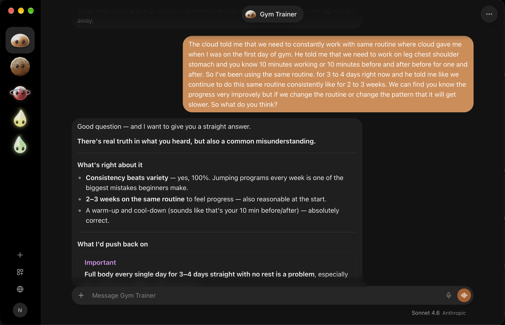

<p align="center">
  
  
  
  
  
  
  
</p>

<h1 align="center">Cookie</h1>
<p align="center"><b>by <a href="https://enkeon.com">Enkeon</a></b></p>

<h3 align="center">Beyond assistants. Agents that grow up.</h3>

<p align="center">A team of AI agents that works on your computer, learns on the job, and asks before it acts.</p>

<p align="center">
  <a href="#the-app">The app</a> ·
  <a href="#run-it">Run it</a> ·
  <a href="#whats-in-this-repo">What's in this repo</a> ·
  <a href="#the-cookie-command">The cookie command</a> ·
  <a href="#open-source-and-enkeon">Open source and Enkeon</a> ·
  <a href="#reference">Reference</a>
</p>

<p align="center">
  
</p>

---

## The app

<p align="center"><sub>The starter crew. Every agent is a small 3D character, drawn live on your Mac in its own shape and colours.</sub></p>
<table align="center">
<tr><td align="center" width="128"><br><sub><b>Inbox Triage</b></sub></td><td align="center" width="128"><br><sub><b>Research Scout</b></sub></td><td align="center" width="128"><br><sub><b>Chief of Staff</b></sub></td><td align="center" width="128"><br><sub><b>Gym Trainer</b></sub></td><td align="center" width="128"><br><sub><b>Writing Desk</b></sub></td><td align="center" width="128"><br><sub><b>Lead Pipeline Desk</b></sub></td></tr>
<tr><td align="center" width="128"><br><sub><b>Invoice Chaser</b></sub></td><td align="center" width="128"><br><sub><b>Meeting Notes</b></sub></td><td align="center" width="128"><br><sub><b>Daily Brief</b></sub></td><td align="center" width="128"><br><sub><b>Travel Planner</b></sub></td><td align="center" width="128"><br><sub><b>Learning Coach</b></sub></td><td align="center" width="128"><br><sub><b>Cookie</b></sub></td></tr>
</table>

Cookie is a desktop app. You hire agents, each with one job in your words,
its own face and its own folder, and talk to them like teammates.

- **Hire for one job.** Pick a starter or write the job yourself and name the
  model (`provider:model`); there is no default model. New hires can start on
  probation: everything they would change is recorded, and nothing changes
  until you say so.
- **Today.** One place for what waits for you: approvals, questions, offers
  from your agents and what their worlds want to send out.
- **Each agent's profile.** About, Skills (with its routines), Memory (with
  its files), Record, Evolution (tests and forks), Computer (its worlds) and
  Share, in one panel. Every agent has an address, like `@you/writing-desk`.
- **Its own computer.** Each agent works in [Parallax](#parallax) worlds that
  copy instantly, rewind and race. Sending, paying or going live waits at the
  wall for your yes.
- **It gets better, and shows you how.** Every change to how an agent works is
  listed with an Undo. Tests and a bench check each change before it stays.
- **Talk or type.** Dictate into the message box, or call an agent and talk
  hands-free. Speech becomes text on your Mac (whisper.cpp) when the model is
  downloaded; replies are spoken by ElevenLabs or the Mac's own voice.
- **Where you already are.** Reach your agents from Slack, Discord, Microsoft
  Teams, Telegram, WhatsApp, Signal, iMessage and mail. Write `@AgentName` and
  what you need.
- **Other people's agents.** Invite another person's agent to talk to yours.
  What arrives is information, never an order, and anything your agent would
  send or change waits for you.

Mail, pages and files are things an agent reads, never orders it takes. Who
gets a message, where money goes and what gets deleted always come from you.

## Run it

Needs macOS, Rust 1.91+ (https://rustup.rs) and the Tauri CLI
(`cargo install tauri-cli --locked`).

```sh
cd desktop
./run.sh          # dev mode: UI changes show live, Rust changes rebuild
```

Add your model keys in Settings → Models (they go to the Keychain), or export
them before starting. `cd desktop/src-tauri && cargo tauri build` makes the app
bundle. A signed download comes with the first desktop release.

To keep the team working while your laptop sleeps, run the same team on
another machine: see [`desktop/RUNNER.md`](desktop/RUNNER.md).

## What's in this repo

| Folder | What it is |
|---|---|
| [`desktop/`](desktop/) | The Cookie app (Tauri): `ui/`, the team that runs your agents (`team/`), addresses and messages between people (`net/`) and the relay that carries them (`relay/`). |
| [`src/`](src/) | The agent harness every agent runs on, and the `cookie` command. |
| [`parallax/`](parallax/) | Parallax, the computer built for agents. |
| [`bindings/`](bindings/) | Python and TypeScript clients for `cookie serve`. |
| [`examples/`](examples/), [`tests/`](tests/), [`evals/`](evals/) | Examples, the test suites and the AgentDojo eval. |

## The cookie command

The harness also runs on its own, in a terminal or on a server.

```sh
curl -fsSL https://raw.githubusercontent.com/DevbyNaveen/cookie-agent/main/install.sh | sh
```

It downloads the latest release for your Mac or Linux machine, checks it
against the SHA-256 published with it, and puts `cookie` in
`/usr/local/bin` (or `~/.local/bin`). Then:

```sh
export ANTHROPIC_API_KEY=sk-ant-...
export TINYFISH_API_KEY=...      # optional: free web search (or EXA_API_KEY, BRAVE_SEARCH_API_KEY)
cd ~/your-project && cookie local
```

From source instead: `cargo install --git https://github.com/DevbyNaveen/cookie-agent --locked`.

Ask it what you would ask a teammate who just read your folder: *"What does
this project do?"*, *"Where do we handle refunds?"*, *"Summarise
https://…"*. It looks through the folder, searches the web, reads pages, and
says where each fact came from: a `path:line` or a page address.

`cookie local` only reads. A page address it found inside a page, a file or a
search result is shown to you before it is opened (`--permission ask`, the
default); `--permission full` opens those straight away. `--model
openai:<model>`, `gemini:…`, `ollama:qwen3` or `bedrock:…` pick another model;
`--session talk.jsonl` keeps the conversation to pick up later. `cookie local
--help` lists everything.

Between conversations it keeps a few notes in `~/.cookie/NOTES.md`: lasting
preferences, facts about your work, corrections. It's one small file you can
read and edit. When it's full, a new note is refused until Cookie replaces or
removes an old one, so nothing is dropped without you seeing it. A note never
holds a secret.

### Drafts that sound like you

Give Cookie a few messages you really sent (`voice` in its profile), and its
drafts match their tone, length, greeting and sign-off without borrowing their
content. Drafts and answers are read for the habits that give AI writing away
(dashes used as punctuation, "it's not X, it's Y", lists of three "no ...",
stock phrases, words about being an AI); one that has them is rewritten once
before it reaches you. The `chase` follow-up, the voice examples and the
check live in `src/cookie/voice.rs` (also a `voice_check` line on
`cookie serve` for any text you want checked).

## Parallax

A computer built for agents: the brains of everyday apps (browser,
spreadsheet, files, documents, PDF, images, video, data) used directly, in
worlds that copy instantly, rewind and race, with four verbs: Preview, Do,
Undo, Branch. It runs inside the app for every agent, and on its own as an
MCP server for Claude Code, Codex, Claude Desktop or ChatGPT. See
[`parallax/README.md`](parallax/README.md).

## Open source and Enkeon

Cookie is open source under the MIT licence. Everything that makes it work
for one person is here. Enkeon makes it work for a whole team.

| In this repo | With Enkeon |
|---|---|
| The app, the harness, Parallax, tools, MCP servers, skills | Cookie for your whole team |
| Each agent's memory on your computer | Your team's shared context, across everyone and every AI tool, backed up |
| Your own Slack bot, mailbox and MCP servers | One-click Gmail, Slack, Drive, Notion, Linear and more |
| The approval rules and the approval card | Team roles: who can give an agent a job, from where |

Set `ENKEON_API_KEY` and anything built here reads and saves to Enkeon.

---

# Reference

## The library

You always name the model (`provider:model`); there is no default.

| Provider | Model id | Needs |
|---|---|---|
| Anthropic | `anthropic:claude-sonnet-4-6` | `ANTHROPIC_API_KEY` |
| OpenAI | `openai:<model>` | `OPENAI_API_KEY` (`OPENAI_BASE_URL` for other compatible servers) |
| Google Gemini | `gemini:gemini-3.8-flash` | `GEMINI_API_KEY` |
| Ollama | `ollama:qwen3` | a running Ollama (`OLLAMA_HOST`, default `localhost:11434`) |
| Amazon Bedrock | `bedrock:eu.anthropic.claude-sonnet-4-6` | feature `bedrock` (Rust 1.91+); `AWS_ACCESS_KEY_ID`, `AWS_SECRET_ACCESS_KEY`, `AWS_REGION` for ids without `eu.`/`us.` |

Keys are read from the environment and never enter the conversation.
Every provider streams its replies.

`.reasoning(Effort::High)` asks the model to think first (Anthropic adaptive
thinking, OpenAI `reasoning_effort`, Gemini `thinkingLevel`, Bedrock
`outputConfig.effort`). What it thinks is kept as the provider sent it and
sent back only to that provider; it is never the answer and never trusted.

`.output_schema(json!({…}))` makes the final answer JSON following that
schema, through each provider's own structured-output setting. The answer is
checked before it is returned (valid JSON, an object where the schema says
so, every `required` key); one that fails is an error.

## Five concepts

| | |
|---|---|
| `Agent` | model + instructions + tools + policy |
| `Tool` | a plain async function, a JSON schema, and an effect: `Read`, `Write`, `Outbound`, `Destroy` |
| `Session` | an append-only JSONL file: resume, branch, replay |
| `Policy` | deterministic gates over effects and where values came from |
| `Provider` | the model backend |

## The trust rule

Every message is labelled by the runtime: the person's words, the
developer's instructions, the model, or **untrusted** (tool output, web,
files, screens, other agents). Arguments that pick who, where or how much
(`.guard("to")`, or a JSON pointer like `.guard("/message/to")`) must be
words the person actually wrote, or on an allow-list. Guard them on every
effect class, `Read` included: a fetch URL can carry data out. `Outbound`
and `Destroy` always ask an `Approver` with a preview of what will
actually happen; the default approver says no.

See `examples/outbound_gate.rs`: a web page tells the agent to email
`evil@x.com`; the call is refused before anyone is asked.

An app with a person at the approval card can ask instead of refusing:
`Policy::default().confirm_data()` (or `"confirm_data": true` on a `run`)
puts such a value to the person, and `ApprovalRequest::from_data` lists what
they didn't write (`to = evil@x.com`) so the card can say so. Earned trust
never answers that kind of ask, and a sub-agent can't turn it on unless its
parent has.

Whatever a model reads, these rules decide what it can *do* with it.

## MCP servers and skills

```rust
let github = McpServer::stdio("github-mcp", &[])
    .effect("search_issues", Effect::Read)   // everything else asks a person
    .guard("create_issue", "repo")
    .pin("3f2a…")                            // refuse it if its tools change
    .connect()
    .await?;
let agent = Agent::new("anthropic:claude-sonnet-4-6")?
    .tools(github.tools)
    .tools(Skills::from_dir("skills")?.into_tools());
```

Every MCP tool asks a person unless you lower it; a server's own hints can
only make a tool stricter. A server's tool descriptions are its words, not yours: offering
them counts as reading untrusted content (so a recipient named in one is
refused), and each is cut at 2,000 characters. `.first_party()` marks a server
you run yourself. The first connection is trust-on-first-use: `connect()` returns
the tool list's SHA-256, and `pin` refuses a server whose tools changed since.
Tool output is always untrusted too, so what a tool returns can never pick who
gets sent what. Skills (`SKILL.md`) are offered through one `use_skill`
tool and loaded on demand; `read_agents_md` gives you `AGENTS.md` to put in
your instructions — nothing is added behind your back.

## From the terminal, or from any language

```sh
cookie run anthropic:claude-sonnet-4-6 "Weather in Riga?" --session riga.jsonl
cookie chat anthropic:claude-sonnet-4-6 --session riga.jsonl   # one run per line
cookie replay riga.jsonl   # run it again from the log: exit 0 if it reproduced
cookie serve    # one JSON object per line on stdin/stdout
```

`cookie chat` asks approvals on the same terminal it reads your lines from;
Ctrl-C stops the answer being written, `/exit` or Ctrl-D leaves. `cookie
replay` calls no model and runs no tool: each reply and each tool result
comes from the file, so it shows whether the loop still does what it did, and
names the first message that differs. In Rust, `Replay::from_session(&s)`
gives the same, and `ReplayProvider` alone replays the model against new tools.

`cookie serve` speaks a small protocol. You send
`{"type":"run","id":"r1","model":"…","input":"…","tools":[{"name":"lookup","effect":"read","schema":{…}}]}`;
you get `event` lines while it works, `tool_call` when the model calls one of
your tools (answer with `tool_result`), `approval` when something needs a
person (answer with `approve` — no answer means no), and `done` or `error`.
`cancel` stops a run now, `finish_turn` after this turn. Your tools go
through the same gates as Rust ones, and their results are untrusted.

A tool declared with `"voice": ["subject", "body"]` has those arguments
read before the call goes anywhere: words that read like an AI's
(`cookie::voice`) send the call back to the model once to be rewritten, and
the rewrite goes through as written. `{"type": "voice_check", "id": "v1",
"text": "…"}` runs the same check on any text, with no model, and answers
`{"ok": false, "problems": [{"rule": "dash", "excerpt": "…"}]}`.

A `run` may also carry, besides `instructions`, `session` (a file to resume),
`skills` (a folder of `SKILL.md` skills, offered through `use_skill`),
`history` (earlier turns, for a client that keeps the conversation itself:
`[{"role": "user", "text": "…"}, {"role": "assistant", "text": "…", "untrusted": true}]`;
the person's turns are theirs, a reply is the model's, and `untrusted` marks a
turn built from a screenshot or file), `confirm_data` (ask about a value from data instead of refusing it; the
approval then carries `from_data`). When one turn has several actions that
need a person, they come as one `approval` with `items` (one card), answered
with `"allow": [true, false, …]` in order; `Approver::approve_batch` is the Rust
side. `allow` (values the person approved in
advance) and `enkeon: false`:

```json
"budget": {"max_steps": 10, "max_tokens": 50000, "max_dollars": 0.50},
"prices": {"input": 3.0, "output": 15.0, "cache_read": 0.3, "cache_write": 3.75},
"mcp": [
  {"command": "github-mcp", "args": [], "effects": {"search_issues": "read"},
   "guards": {"create_issue": ["repo"]}, "pin": "3f2a…"},
  {"url": "https://mcp.example.com/mcp", "headers": {"Authorization": "Bearer …"}, "prefix": "ex"}
]
```

A limit left out keeps its default (25 model calls, 200,000 tokens, no dollar
cap); a dollar cap needs `prices` (dollars per million tokens — you supply them). Each MCP
server is connected for that run only and works as in Rust: every tool asks
a person unless `effects` lowers it, and a `pin` refuses a server whose tool
list changed. A server that can't be reached, or fails its pin, ends that
run with an `error`. Unknown fields are refused, here as everywhere.

A `run` may also carry `"images": [{"media_type": "image/png", "data":
"<base64>", "source": "screen", "caption": "…"}]` (source `screen`, the
default, `web` or `file`; one source per run). They go in as one untrusted
message right after `input`. See *Images*.

Clients that do this for you: `bindings/python` (`cookie_harness`, standard
library only) and `bindings/typescript` (`@cookie-harness/client`, no runtime
dependencies). `evals/agentdojo` runs AgentDojo through the Python one.

## Images

```rust
let shot = Message::untrusted_image("image/png", &png_bytes, Source::Screen)?;
agent.run_streaming_all(&mut session, vec![Message::user("Answer this mail"), shot], &control, &mut |_| {}).await?;
```

An image is always untrusted, like a web page: text visible in a screenshot
is never the person's words, so it can't pick a recipient, and reading one
counts as having read untrusted content. `Message::untrusted_images` takes
several images and caption text (untrusted too) as one message. Accepted:
`image/png`, `image/jpeg`, `image/gif`, `image/webp`, whose bytes must match
the type; at most 3,750,000 bytes each and 20 per message (Bedrock's limits,
the smallest documented). Each provider gets the image in its own format,
after a fenced note saying what follows is untrusted. In long sessions an
image counts as 1,600 tokens, is written as `[image: image/png, 120 KB]` in
summaries, and is cleared from old turns like tool output.

Image data is standard base64 (line breaks are fine; they are removed). Images
are kept in the session file like everything else — clearing old turns only
changes what the model is sent — so a session with many screenshots grows
large on disk.

## Tracing

Every run emits OpenTelemetry GenAI spans through `tracing`:
`invoke_agent`, `chat {model}` and `execute_tool {tool}`, with provider,
model, token usage, tool call id and `error.type` — never message content.
The GenAI conventions are still marked Development, so the names may change.

`cookie serve` writes them as JSON lines on **stderr** (stdout stays the
protocol): one line per span as it closes, with its timings, and one per
warning. `RUST_LOG` picks what is logged — warnings only by default,
`RUST_LOG=cookie_harness=info` for every span. To send spans to an
OpenTelemetry collector instead, embed the library and add
`tracing-opentelemetry` to your own subscriber; the harness itself ships no
exporter.

## Enkeon (on when you have a key)

Set `ENKEON_API_KEY` (or sign in with the Enkeon CLI — its current project is
used, `ENKEON_PROJECT` picks another) and every agent gets the person's context from
[Enkeon](https://enkeon.com): a `recall` tool to look things up and a
`remember` tool to save what lands. The system prompt gains one paragraph,
`ENKEON_INSTRUCTIONS` — read it in `src/enkeon.rs`; nothing else is added.

```rust
let agent = Agent::new("anthropic:claude-sonnet-4-6")?;                 // with ENKEON_API_KEY set: on
let agent = Agent::new("anthropic:claude-sonnet-4-6")?.without_enkeon(); // off
```

What `recall` returns is tool output: untrusted, so saved context can't
choose who gets sent what. Saved context may hold text from a web page, so once a
run has recalled or read anything, `remember` asks a person first — set an
`approver`, or the default declines and nothing is saved. Sub-agents can
recall but not save. If Enkeon can't be reached within 10 s the run still
answers and you get `Event::EnkeonUnavailable`. The key is only sent over
https (or to this machine) and never follows a redirect. No key, no
connection — and since the key comes from the environment, call
`.without_enkeon()` in tests that assert on prompts or tools. Remote MCP servers work the same way: `McpServer::http(url)`.

## Several agents

```rust
let researcher = SubAgent::reader("research", "Looks things up", research_agent)?;
let mailer = SubAgent::writer("mailer", "Sends email", mail_agent)?;
let lead = Agent::new("anthropic:claude-sonnet-4-6")?.tool(researcher).tool(mailer);
```

A sub-agent is a tool: it runs in a fresh context that holds only its task,
and its answer comes back as untrusted output. It inherits the parent's
trust exactly — a recipient the parent couldn't use, the child can't use
either, because the task is the parent model's words, not the person's.
Readers hold only `Read` tools; one agent per tree may change things.
Children spend from what the parent has left — siblings running side by
side share it — and stop when the parent is cancelled. A child allows only
destinations its parent allows, and asks whoever its parent asks unless it
has its own approver. Delegation goes at most 3 levels deep. A long answer
comes back as its start and an id (`art-1`); the parent reads more with
`read_artifact` if it needs to.

To pass the conversation itself on, use a handoff: the next agent carries
on in the same session, with the same budget and the person's words still
credited. At most 5 hops per run.

```rust
let front = Agent::new("anthropic:claude-haiku-4-5")?
    .tool(Handoff::to("billing", "Questions about invoices", billing_agent));
```

## Earned trust

```rust
let agent = agent.earned_trust(EarnedTrust::open("trust.json", 5)?);
```

After a person approves the same `write` tool 5 times in a row, it runs
without asking, and `Event::RanOnEarnedTrust` says so. Only a person counts:
the approver must be a `PersonApprover` (your UI) or the terminal — a rule
or script (`FnApprover`) never earns trust. Trust belongs to one tool
definition, so another tool with the same name earns nothing. One "no"
resets it; `revoke` takes it back, and the file is re-read on every check, so
a revoke from another process stands. Tools that send, delete or pay are
never earned.

## Reading untrusted text through a quarantine

```rust
let reader = Agent::new("anthropic:claude-haiku-4-5")?;  // no tools
let orders = quarantine(read_email, reader, json!({"type": "object", "properties": {
    "order": {"type": "string", "maxLength": 20}, "total": {"type": "number"}}}))?;
```

The email is read by a model with no tools, and only fields that match the
schema come back — no extra keys, strings capped at 200 characters unless
you say otherwise. An instruction hidden in the email has nowhere to go but
those fields. They are still untrusted (after CaMeL).

## Many tools

`agent.tool_search(ToolSearch { after: 30, top_k: 5 })`: past 30 tools the
model gets one `search_tools` tool instead of every definition, and what it
finds is offered for the rest of the run. Every call still goes through the
gates.

## Limits

`Budget { max_steps, max_tokens, max_dollars }` caps each run; a cap stops
the run, it never just warns. Dollars need `agent.prices(Price { input,
output, cache_read, cache_write })` in dollars per million tokens — you
supply them; the harness ships no price table, because a stale one lies.

## Shell commands, sandboxed

```rust
let sandbox = cookie_harness::sandbox::detect().expect("no sandbox here");
let agent = Agent::new("anthropic:claude-sonnet-4-6")?.tool(command_tool("sh", sandbox, "./work")?);
```

`command_tool` runs `sh -c <command>` in one directory, the only place it may
write. Inside a sandbox it has no network and cannot ask other apps to act
(no Apple Events, no `open`, no XPC services), cannot read credentials
(`~/.ssh`, `~/.aws`, keychains and the like — `SECRET_PATHS`), runs with a
cleared environment (keys never reach it), a timeout (60 s, `.timeout(..)`),
and stdout/stderr cut at 32 KB each, saying so.

`detect()` picks macOS `sandbox-exec` or Linux `bwrap`, after trying it once.
On macOS the profile is closed by default — OpenAI Codex's base policy
(Apache-2.0, see THIRD_PARTY_NOTICES.md) plus the rules above — and is tested
here against Apple Events, `open`, credential reads, the network and writes
outside the directory. bubblewrap needs unprivileged user namespaces. With neither, `detect()` returns `None`;
`NoSandbox` confines nothing, so every command then asks a person.

The command is the model's choice, so inside a sandbox it is a `Write` tool:
after the run has read anything untrusted, a person is asked first, shown the
command.

## Other parties' agents (A2A)

```rust
let planner = A2aAgent::discover("https://planner.example.com").await?
    .credential("bearer", &token)?;            // only if you have one; a scheme its card declares
let agent = Agent::new("anthropic:claude-sonnet-4-6")?.tool(planner.tool("route_planner"));
```

`discover` reads `/.well-known/agent-card.json` (https, or plain http to this
machine; no redirects; capped at 4 MB) and uses the first JSON-RPC A2A 1.x
interface the card lists. The tool sends one text message (`SendMessage`),
polls `GetTask` until the task ends, and cancels it (`CancelTask`) when the run
is cancelled or `.timeout(..)` (300 s) passes. Sending a task to someone else
is `Outbound`, so a person is always asked. What comes back is untrusted tool
output and starts with the agent's name and host. A credential is sent only
when you give one, the way the card's scheme says (HTTP auth, an API key in a
header, or an OAuth/OpenID bearer token you obtained); none is ever made up.
`AgentCard::new(..).jsonrpc(url).skill(..)` writes a card in the spec's JSON
shape, for when a cookie agent is served.

## Long sessions

`.compaction(Compaction { clear_tool_results_after, summarize_above_tokens, keep_recent_turns, ..Compaction::default() })` (`.with_prompt(..)` replaces the summary instruction)
clears old tool output from what the model sees and, past the token limit,
replaces older turns with a summary (`SUMMARY_PROMPT`, public). The session
file keeps every message. What the person wrote before a summary still
counts as theirs; a summary of untrusted content stays untrusted.

On Anthropic, the server can clear old tool results instead (beta):
`Agent::with_provider(Arc::new(AnthropicProvider::from_env()?.context_editing(ClearToolUses::default())), model)`.
What it cleared is reported as a `tracing` event.

## What Cookie may do in someone's apps

`cookie serve` is how Enkeon runs Cookie as a team's AI teammate, and the
same rules ship here (`src/cookie/permission.rs`, one `permission` line per
action). In order:

1. **The person's own "never" rule** for that app action wins, at every level.
2. **A read runs.**
3. **Who, where and how much** (a recipient, an address, a link, an
   amount, a phone number) must come from the person's own words or the
   team's own records. A value that only appears in mail, a page or another
   tool's result waits for the person, at every level — "full" included.
4. **Caps per job:** after 20 changes, or 10 recipients, the next one waits.
5. **The person's "always" rule** lets that action run without asking.
6. **The level the person chose:** `ask` (every change waits), `smart`
   (Cookie decides, and a separate judge model that sees only the person's
   words and the change checks it; sends and deletes always wait), `full`
   (changes run; sends and deletes are held for 120 seconds so they can be
   undone).

The cases are fixed in `tests/consent_safety.rs` and run on every change; a
case is never edited to make a change pass.

## Evals

```sh
cargo test --test consent_safety     # what Cookie may do without asking: 20 fixed cases
cargo test                           # everything, offline, on scripted models
```

`evals/agentdojo` runs AgentDojo through `cookie serve`, with the trust layer
on and off.

## Contributing

Issues and pull requests are welcome. Before a pull request:

```sh
cargo test --all-features
cargo clippy --all-features --all-targets -- -D warnings
```

Tests never reach the network or a model: the scripted provider
(`providers::scripted`) stands in for one. A change to what Cookie may do
without asking adds a case to `tests/consent_safety.rs`; it never edits one.

**Every bug becomes a test.** A bug is fixed only together with a test that
fails without the fix, named for what it protects and holding the input that
broke it. An input that ever broke a text function also goes into
`CRASHED` in `src/fuzz.rs`, so every fuzz test tries it first from then on.
A function that cuts, finds or slices text gets a fuzz test there: thousands
of seeded strings in every script (multi-byte letters, combining marks,
emoji, right-to-left text, HTML, JSON), so a byte index that lands inside a
character fails in CI, not on someone's page.

## Licence

MIT
